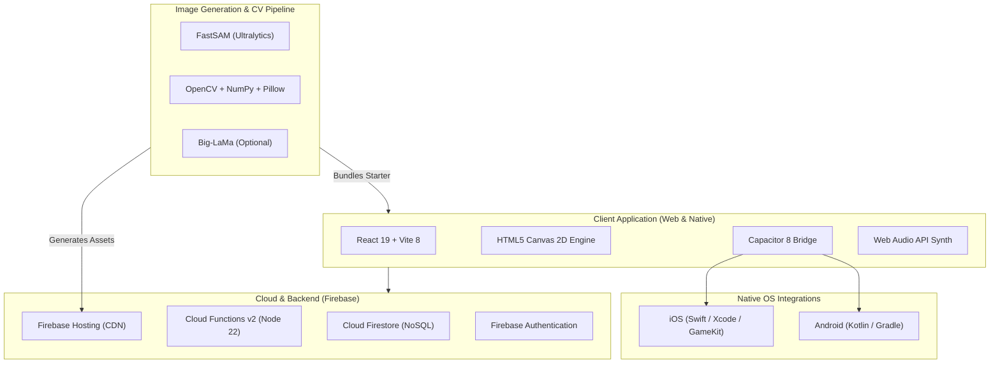
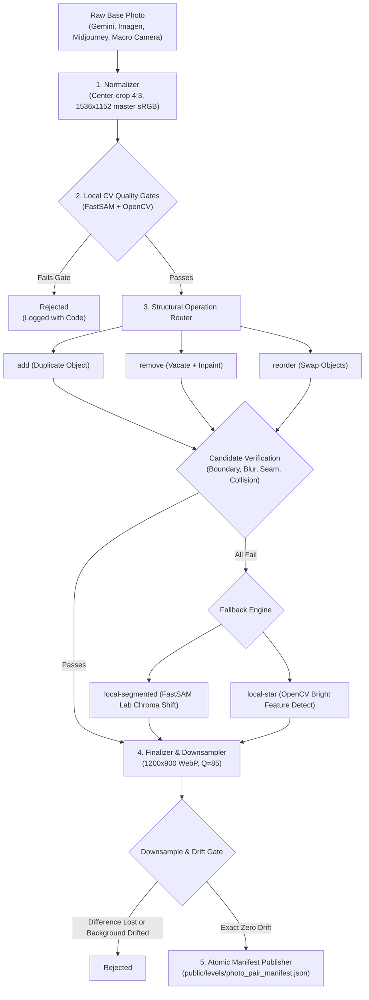

# Diff Hunter — Tech Stack & Architecture Specification

> **Version:** 1.0.0  
> **Target Platforms:** iOS (App Store), Android, Web (PWA / Firebase Hosting)  
> **Status:** Production / Active  

---

## 1. Executive Summary

**Diff Hunter** is a high-performance, cross-platform spot-the-difference game built with **React 19**, **Vite 8**, **Capacitor 8**, and **Firebase**. The application features two distinct gameplay experiences:
1. **Photographic Mode**: Real-world and photorealistic macro scenes processed through an offline computer vision and structural AI pipeline that creates subtle, pixel-perfect differences.
2. **Abstract Mode**: A 100% client-side, procedural 2D vector art engine rendering complex multi-scale scenes across 12 artistic worlds in real time.

The system is designed with an **offline-first hybrid architecture**: core gameplay and starter levels are bundled directly into the native mobile app binary, while extended level packs are streamed on-demand via CDN. Competitive integrity is enforced through server-authoritative Firebase Cloud Functions for global leaderboards and anti-cheat verification.

---

## 2. Tech Stack Matrix



### Detailed Component Inventory

| Category | Component / Library | Location / Config | Role & Purpose |
| :--- | :--- | :--- | :--- |
| **Frontend Framework** | React 19 (`react`, `react-dom`) | [`package.json`](file:///Users/leemosupreemo/projects/spot-difference-game/package.json#L41-L42) | UI layout, view routing, modal system, hooks |
| **Build & Dev Tooling** | Vite 8 + `@vitejs/plugin-react` | [`vite.config.js`](file:///Users/leemosupreemo/projects/spot-difference-game/vite.config.js) | Fast HMR dev server, production tree-shaking and asset bundling |
| **Mobile Runtime** | Capacitor 8 (`@capacitor/core`, `ios`, `android`) | [`capacitor.config.json`](file:///Users/leemosupreemo/projects/spot-difference-game/capacitor.config.json) | Cross-platform web-to-native runtime bridge |
| **Native Plugins** | `@capacitor/haptics`, `local-notifications`, `share`, `status-bar`, `filesystem` | [`package.json`](file:///Users/leemosupreemo/projects/spot-difference-game/package.json#L29-L34) | Native hardware features, push reminders, share sheet, local file cache |
| **Native Platform Shells** | Swift / Xcode (iOS), Gradle (Android) | [`ios/`](file:///Users/leemosupreemo/projects/spot-difference-game/ios), [`android/`](file:///Users/leemosupreemo/projects/spot-difference-game/android) | App Store and Google Play binary shells, CocoaPods, GameKit |
| **Canvas & Graphics** | HTML5 2D Canvas, Lucide React, `canvas-confetti` | [`src/components/GameCanvas.jsx`](file:///Users/leemosupreemo/projects/spot-difference-game/src/components/GameCanvas.jsx) | High-DPI canvas renderer, zoom/pan transform matrices, hit testing, victory VFX |
| **Audio Engine** | Custom Web Audio API synthesizer & sound manager | [`src/utils/audio.js`](file:///Users/leemosupreemo/projects/spot-difference-game/src/utils/audio.js), [`src/utils/music.js`](file:///Users/leemosupreemo/projects/spot-difference-game/src/utils/music.js) | Low-latency synthesized procedural SFX and music without large audio file downloads |
| **Database & Auth** | Firebase Firestore, Firebase Authentication | [`src/services/firestoreClient.js`](file:///Users/leemosupreemo/projects/spot-difference-game/src/services/firestoreClient.js), [`authService.js`](file:///Users/leemosupreemo/projects/spot-difference-game/src/services/authService.js) | Anonymous auth, player stats persistence, remote daily queues |
| **Serverless Backend** | Firebase Cloud Functions v2 (Node 22) | [`functions/index.js`](file:///Users/leemosupreemo/projects/spot-difference-game/functions/index.js) | Server-authoritative leaderboard submission, anti-cheat validation, profanity filter |
| **Hosting & Asset CDN** | Firebase Hosting | [`firebase.json`](file:///Users/leemosupreemo/projects/spot-difference-game/firebase.json) | Global edge distribution for web app and lazy-loaded remote level packs |
| **Image Gen & CV** | Python 3, Ultralytics FastSAM, OpenCV, NumPy, Pillow | [`requirements-generation.txt`](file:///Users/leemosupreemo/projects/spot-difference-game/requirements-generation.txt) | Object segmentation, structural differences (`add`/`remove`/`reorder`), CV quality gates |
| **Telemetry & Crashes** | Sentry (`@sentry/react`, `@sentry/capacitor`) | [`src/services/sentry.js`](file:///Users/leemosupreemo/projects/spot-difference-game/src/services/sentry.js) | Real-time crash diagnostics, error boundaries, native crash logs |
| **Product Analytics** | Mixpanel (`mixpanel-browser`) | [`src/services/analytics.js`](file:///Users/leemosupreemo/projects/spot-difference-game/src/services/analytics.js) | Player funnels, stage completions, retention metrics, BI dashboards |
| **Testing & Linter** | Node Test Runner, Vitest, Oxlint, Puppeteer Core | [`package.json`](file:///Users/leemosupreemo/projects/spot-difference-game/package.json#L9) | Unit tests, UI component tests, linting, visual screenshot regression |

---

## 3. Architecture Deep-Dive

### 3.1 Client Architecture (MVVM Pattern)

The frontend follows a clean **Model-View-ViewModel (MVVM)** pattern:

```
┌──────────────────────────────────────────────────────────────┐
│                            VIEWS                             │
│   MainMenu.jsx │ GameCanvas.jsx │ VictoryModal.jsx │ Modals  │
└──────────────────────────────▲───────────────────────────────┘
                               │ User Interactions & State
┌──────────────────────────────┴───────────────────────────────┐
│                          VIEWMODEL                           │
│                 src/viewmodels/useGameViewModel.js           │
│  - Gameplay Loop & Stage Tracking                            │
│  - High-Precision Timers & Speed-Point Calculations          │
│  - Input Hit Testing & Zoom/Pan Viewport State               │
│  - Offline / Online Mode Routing                             │
└──────────────────────────────▲───────────────────────────────┘
                               │ State Synchronization & RPC
┌──────────────────────────────┴───────────────────────────────┐
│                       SERVICES & UTILS                       │
│  leaderboardService.js │ dailyChallenge.js │ remoteLevelSync │
│  playerProgress.js     │ audio.js          │ analytics.js    │
└──────────────────────────────────────────────────────────────┘
```

1. **View Layer**: Pure functional React components rendering UI chrome, modals, animations, and the central Canvas viewport.
2. **ViewModel Layer ([`useGameViewModel.js`](file:///Users/leemosupreemo/projects/spot-difference-game/src/viewmodels/useGameViewModel.js))**: Encapsulates state for found differences, miss counters, magnifier tool, active timers, score calculations, and curation debug tools.
3. **Canvas Viewport ([`GameCanvas.jsx`](file:///Users/leemosupreemo/projects/spot-difference-game/src/components/GameCanvas.jsx))**:
   - Manages dual-pane side-by-side or stacked image views with synchronized zoom and pan transforms.
   - Computes normalized coordinate mappings $(x, y \in [0, 1])$ to handle responsive device sizes and arbitrary aspect ratios.
   - Emits visual feedback (ripple animations, red miss indicators, green difference discovery markers).

### 3.2 Dual Gameplay Modes

#### A. Photographic Mode
- Loads paired WebP images (Master Base + Modified Variant).
- Differences are represented by normalized bounding boxes and target center points stored in [`public/levels/photo_pair_manifest.json`](file:///Users/leemosupreemo/projects/spot-difference-game/public/levels/photo_pair_manifest.json).
- Supports offline starter sets (bundled in app binary) and extended downloadable packs (streamed over CDN).

#### B. Procedural Abstract Mode ([`src/utils/proceduralGenerator.js`](file:///Users/leemosupreemo/projects/spot-difference-game/src/utils/proceduralGenerator.js))
- Generates 100% algorithmic vector scenes on-the-fly directly to HTML5 Canvas contexts.
- Features **12 Artistic Worlds** (e.g. *Monet Giverny Water Lilies*, *Van Gogh Starry Cypress*, *Retro Synthwave Neon*, *Mondrian & Bauhaus*, *Hokusai Wave*).
- Composes 85–110 hierarchical vector shapes (from 4px micro-details up to 360px structural elements) with guaranteed single high-contrast differences (color shift, shape rotation, detail removal/addition, or scale morph) without asset loading overhead.

---

## 4. Image Generation & Computer Vision Pipeline

The photographic difference pipeline is completely autonomous, running locally using computer vision without expensive, billable cloud image editing APIs.



### Pipeline Stages

1. **Normalization ([`scripts/generate_photo_batch.py`](file:///Users/leemosupreemo/projects/spot-difference-game/scripts/generate_photo_batch.py))**:
   - Crops source images to exact 4:3 aspect ratio (rejecting with `NormalizationCropExceeded` if crop exceeds 0.5%).
   - Resizes to standard canonical master resolution: $1536 \times 1152$ pixels.
2. **Local Computer Vision Quality Gates ([`scripts/scene_affordance_router.py`](file:///Users/leemosupreemo/projects/spot-difference-game/scripts/scene_affordance_router.py))**:
   - **Sharpness Uniformity**: $\ge 0.25$ across image quadrants.
   - **Global Edge Density**: $\ge 0.02$.
   - **FastSAM Instance Count**: Minimum 18 detected discrete objects (`FastSAM-s.pt`).
   - **Editable Target Count**: Minimum 8 candidate objects occupying $0.1\% - 1.4\%$ frame area.
   - **Peer Groups**: Minimum 2 repeated visual families (e.g. screws, buttons, components).
   - **Hero Object Cap**: Largest object must not exceed $22\%$ of the total frame.
3. **Structural Operation Engine ([`scripts/unified_operation_pipeline.py`](file:///Users/leemosupreemo/projects/spot-difference-game/scripts/unified_operation_pipeline.py))**:
   - `add`: Selects a clean segmented object and duplicates it into a plausible context-free zone.
   - `remove`: Vacates an object and reconstructs the background surface using boundary interpolation or optional Big-LaMa (`big-lama.pt`).
   - `reorder`: Repositions or swaps two similar objects within the scene.
4. **Fallback Recolor Engines**:
   - `local-segmented`: Modifies chroma in the CIELAB color space inside tight FastSAM masks.
   - `local-star`: OpenCV multi-scale bright-feature detector for astronomy and starfield images.
5. **Finalization & Anti-Drift Verification ([`scripts/image_pair_finalizer.py`](file:///Users/leemosupreemo/projects/spot-difference-game/scripts/image_pair_finalizer.py))**:
   - Dual downsampling to canonical production resolution: $1200 \times 900$ WebP (Quality 85).
   - Verifies the difference region remains distinctly visible at downscaled $800 \times 600$ viewport resolution.
   - **Zero Drift Guarantee**: Strictly verifies that every pixel outside the edited boundary matches the master base image with 0% drift.

---

## 5. Backend, Storage & Distribution

### 5.1 Asset Partitioning & Packaging

| Asset Tier | Storage Location | Size Target | Delivery Strategy |
| :--- | :--- | :--- | :--- |
| **Starter Level Packs** | `public/levels/` | $\approx 25\text{ MB}$ | Bundled directly inside iOS / Android app binary; zero-network instant start |
| **Remote Level Packs** | `remote-levels/` | $\approx 10-15\text{ MB}$ per pack | Staged to Firebase Hosting CDN; lazy-loaded and cached in local storage on-demand |
| **Daily Challenge Queue** | Cloud Firestore | Minimal JSON metadata | Globally synced daily puzzle sequence managed via [`scripts/manage_daily_queue.mjs`](file:///Users/leemosupreemo/projects/spot-difference-game/scripts/manage_daily_queue.mjs) |

### 5.2 Security & Anti-Cheat Architecture

All competitive leaderboards are processed through **Firebase Cloud Functions v2** ([`functions/index.js`](file:///Users/leemosupreemo/projects/spot-difference-game/functions/index.js)):
- **Elapsed Time Enforcement**: Minimum time threshold of $1000\text{ ms}$ baseline; impossible clear times are automatically rejected.
- **Single-Player Deduplication**: Automatically keeps only the single best elapsed time / highest score per player per board.
- **Server-Side Profanity Filter**: Leetspeak-aware (`$->s`, `@->a`, `0->o`) blacklist filtering prevents inappropriate hunter tags from reaching the global leaderboard.
- **Apple Game Center Parity**: On iOS devices, verified leaderboard scores are mirrored to native GameKit leaderboards.

---

## 6. Telemetry, Analytics & QA

- **Mixpanel (`mixpanel-browser`)**: Tracks game funnels (`Game Started` $\rightarrow$ `Image Pair Completed` $\rightarrow$ `Stage Cleared`), daily challenge engagement, help/hint usage, and retention cohorts.
- **Sentry (`@sentry/react`, `@sentry/capacitor`)**: Captures unhandled client exceptions, React error boundary crashes, and native iOS/Android bridge errors.
- **Visual Regression Testing**: Headless Puppeteer test harness ([`scripts/capture_modal_screenshots.mjs`](file:///Users/leemosupreemo/projects/spot-difference-game/scripts/capture_modal_screenshots.mjs)) verifies modal rendering, layout responsiveness, and screenshot baselines across standard device resolutions.
